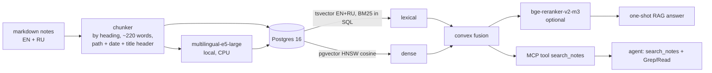

# personal-rag-eval

**How should an AI assistant search one person's notes?** This repo puts four approaches side by side on a
bilingual (English + Russian) personal notebook and grades them on a 119-question gold set, with scoring that
needs no LLM judge:

- **one-shot RAG**: hybrid retrieval in Postgres (BM25 + pgvector + a cross-encoder), top chunks go to the model;
- **agent with grep**: the model searches the notes folder itself with Grep/Glob/Read, the way a coding agent would;
- **agent + search tool**: the same agent also gets the hybrid retriever as an MCP tool;
- **whole notebook in the prompt**: no retrieval, with prompt caching.


## Findings

1. **One-shot RAG is the weakest way to answer.** Its best version (hybrid + reranker) gets **92%** right.
   An agent that greps for itself gets **98%** and the whole notebook in context gets **100%**. When retrieval
   misses, one-shot RAG has nothing else to try. Most of its misses are multi-hop and paraphrased questions.
2. **Giving the agent a search tool keeps its accuracy and makes it cheaper.** The agent with the hybrid
   `search_notes` tool scores **99%**, the same as the grep agent. It reads **31% fewer input tokens**
   (25k vs 36k per question), costs **27% less** and takes fewer steps (3.5 vs 4.6 turns).
3. **That gap grows with the notebook.** At 3.4× the notes (1,138 notes, ~103k words), the grep agent's tokens
   rise to 43k (**+18%**). The search-tool agent stays at **25k (−42% vs grep)**. The whole-notebook prompt
   grows linearly to **270k tokens** and **2.8×** the cost ($0.087 vs $0.031). Somewhere around 4,000 notes it no
   longer fits a 1M context window at all.
4. **Retrieval quality: semantic search does the heavy lifting.** Naive keyword grep puts the right note in the
   top 5 for **61%** of questions. Hybrid search with a reranker does it for **89%**. On questions asked in a
   different language than the note, the scores are **9% vs 100%**.
5. **Plain RRF fusion made hybrid search worse than dense alone** (hit@5 0.77 vs 0.87). BM25 returns many loosely
   matching chunks, and RRF rewards chunks that appear in both lists over a clear dense winner. A convex
   combination of min-max-normalised scores (dense weight 0.7) fixed it. The weight was chosen on the
   hand-written half of the gold set and then checked on the synthetic half.
6. **A small model can answer from the whole notebook if the instructions are repeated after it.** With the
   format instructions only in front of the ~100k-token notebook, Claude Haiku 4.5 ignored the output format
   and scored 84%. Repeating them after the notes brought it to **99% at $0.020 per question**.


## Results

### Answers (end to end, 119 questions)

333-note notebook (`corpus/`), answering model Claude Sonnet 5.5 unless marked `@haiku`:

| system | correct, 95% CI | answerable correct | right "not found" on unanswerable | cites a gold note | median input tokens | mean cost $ |
|---|---|---|---|---|---|---|
| agent+search | **0.99** [0.97–1.00] | 0.99 | 1.00 | 0.99 | 25,152 | 0.029 |
| agentic-grep | 0.98 [0.96–1.00] | 0.98 | 1.00 | 0.97 | 36,367 | 0.040 |
| full-context | 1.00 [1.00–1.00] | 1.00 | 1.00 | 0.99 | 102,600 | 0.031 |
| rag:hybrid+rerank | 0.92 [0.87–0.97] | 0.93 | 0.88 | 0.92 | 8,606 | 0.017 |
| rag:hybrid | 0.87 [0.82–0.93] | 0.86 | 1.00 | 0.87 | 8,298 | 0.015 |
| rag:dense | 0.87 [0.82–0.93] | 0.87 | 0.88 | 0.89 | 8,371 | 0.016 |
| full-context@haiku | 0.99 [0.98–1.00], 3 runs | 0.99 | 1.00 | 0.97 | 75,003 | 0.014 |
| agentic-grep@haiku | 0.92 [0.87–0.96], 3 runs | 0.95 | 0.50 | 0.90 | 29,668 | 0.026 |
| rag:hybrid@haiku | 0.87 [0.81–0.93] | 0.86 | 1.00 | 0.83 | 10,575 | 0.009 |

Intervals are 95% percentile bootstrap over questions ([`eval/stats.py`](eval/stats.py)). Against agentic grep on
the same questions (paired bootstrap), every one-shot RAG variant is worse with the interval excluding zero
(rag:hybrid −0.11 [−0.17, −0.05], rag:hybrid+rerank −0.06 [−0.12, −0.01]); agent+search (+0.01 [−0.02, +0.04])
and the whole notebook in context (+0.02 [+0.00, +0.04]) are not distinguishable from it on 119 questions.

Run-to-run noise, three identical runs: agentic-grep@haiku 0.924 / 0.924 / 0.916, with 5% of questions flipping
between right and wrong; full-context@haiku 0.992 in all three, 1.7% flipping. So differences of one or two
points between agent setups are within noise; the gap to one-shot RAG is not. Rows with 3 runs are pooled over
the runs.

1,138-note notebook (`corpus/` + `archive/`, the same questions):

| system | correct | median input tokens | mean cost $ |
|---|---|---|---|
| agent+search | 0.98 | 25,087 | 0.034 |
| agentic-grep | 0.99 | 43,109 | 0.044 |
| full-context | 0.99 | 269,976 | 0.087 |
| rag:hybrid+rerank | 0.91 | 9,658 | 0.017 |
| rag:hybrid | 0.83 | 9,321 | 0.016 |

Breakdowns by question type are in [`eval/results/answers.md`](eval/results/answers.md) and
[`eval/results/answers-xl.md`](eval/results/answers-xl.md).

### Retrieval only (111 answerable questions, note-level)

| retriever | hit@1 | hit@5 | recall@5 | MRR | median latency |
|---|---|---|---|---|---|
| grep (keyword count) | 0.33 | 0.61 | 0.58 | 0.46 | 2 ms |
| BM25 in Postgres | 0.41 | 0.63 | 0.60 | 0.52 | 5 ms |
| dense (pgvector, e5-large) | 0.57 | 0.87 | 0.82 | 0.69 | 142 ms |
| hybrid, RRF | 0.45 | 0.77 | 0.70 | 0.59 | 146 ms |
| hybrid, convex 0.7 | 0.57 | 0.87 | 0.82 | 0.71 | 147 ms |
| hybrid + bge-reranker-v2-m3 | **0.67** | **0.89** | **0.86** | **0.76** | 9.4 s (CPU) |

hit@5 by question type, and the same table for the large notebook, are in
[`eval/results/retrieval.md`](eval/results/retrieval.md) and
[`eval/results/retrieval-xl.md`](eval/results/retrieval-xl.md).

### Date-aware retrieval

Notes go stale: the March note and the July note both match "what is my hourly rate", and plain relevance ranks
them about the same. `hybrid+dates` ([`src/prag/dates.py`](src/prag/dates.py)) adds two things on top of the
convex hybrid:

- **date filters** `since` / `until` on the chunk date (front matter `created`, else a date in the file name, else,
  with `PRAG_DATE_FROM_MTIME=1`, the file's modification time);
- **a recency term**: score = (1 − w)·relevance + w·2^(−age / half-life), applied in `auto` mode only to questions
  that ask for the current, latest or final value (a small EN/RU keyword detector). Settings:
  `PRAG_RECENCY=off|auto|always`, `PRAG_RECENCY_WEIGHT` (w = 0.3), `PRAG_RECENCY_HALF_LIFE_DAYS` (90), `PRAG_TODAY`.
  The defaults were set before the run, not tuned on the gold set.

Paired comparison with the plain hybrid on the same index (eval date 2026-09-30; * = the interval excludes 0):

| questions | hit@5 hybrid → +dates | difference | MRR difference |
|---|---|---|---|
| all answerable (111) | 0.86 → 0.88 | +0.02 [0.00, +0.05] | +0.01 [0.00, +0.02] * |
| temporal (18) | 0.78 → 0.89 | +0.11 [0.00, +0.28] | +0.05 [+0.01, +0.11] * |
| flagged as "current value" (14) | 0.79 → 0.93 | +0.14 [0.00, +0.36] | +0.06 [+0.01, +0.14] * |

In `auto` mode only 4 questions change rank and all improve; nothing gets worse. With recency on every question
(`always`, a control run) temporal questions gain a little more, but ordinary lookups lose (one gold note drops
from rank 6 to 12, another from 11 to 23), which is why `auto` is the default. Details:
[`eval/results/compare-dates.md`](eval/results/compare-dates.md),
[`eval/results/compare-dates-always.md`](eval/results/compare-dates-always.md).

### Embedding models

Does the 560M-parameter e5-large earn its cost? The same corpus is indexed three times, once per embedder, each in
its own database (`PRAG_DSN`, `PRAG_EMBED_MODEL`, `PRAG_EMBED_DIM`). The E5 query/passage prefixes are kept for E5
models only. BM25 and the fusion weight (0.7) stay the same. All three runs use the current corpus, so the e5-large
row can differ by a point from the table above.

| embedder | dims | dense hit@5 | dense MRR | hybrid hit@5 | hybrid MRR | median query ms |
|---|---|---|---|---|---|---|
| multilingual-e5-large | 1024 | 0.87 [0.81–0.93] | 0.69 | 0.86 [0.80–0.93] | 0.71 | 125 |
| multilingual-e5-base | 768 | 0.77 [0.69–0.85] | 0.61 | 0.81 [0.74–0.88] | 0.64 | 43 |
| bge-m3 | 1024 | 0.85 [0.77–0.91] | 0.65 | 0.86 [0.80–0.93] | 0.70 | 135 |

Paired against e5-large on the same 111 questions (* = the interval excludes 0):

- **e5-base is clearly worse.** Dense: hit@5 −0.10 [−0.17, −0.03] *, MRR −0.08 [−0.15, −0.02] *. Hybrid:
  hit@5 −0.05 [−0.12, +0.01], MRR −0.07 [−0.11, −0.02] *. BM25 recovers about half of the hit@5 loss. In exchange,
  queries are about 3× faster on CPU.
- **bge-m3 matches e5-large inside hybrid search.** Hybrid: hit@5 +0.00 [−0.06, +0.06], MRR −0.00 [−0.05, +0.05].
  Dense alone is slightly behind: hit@5 −0.03 [−0.09, +0.04], MRR −0.04 [−0.09, +0.02], neither significant. The
  question types differ: bge-m3 is better on paraphrases (hybrid 0.83 vs 0.70) and worse on multi-hop questions
  (0.75 vs 1.00). With 8 to 23 questions per type, these per-type differences are not significant.

Indexing the 518 chunks took 63 s with e5-base and 168 s with bge-m3. e5-large was not re-indexed for this run.
Details: [`eval/results/retrieval-emb.md`](eval/results/retrieval-emb.md),
[`eval/results/compare-emb.md`](eval/results/compare-emb.md); reproduce with `eval/compare_embeddings.py`.

## How it works



- **Storage:** one `chunks` table in Postgres 16 holds a generated `tsvector` (English and Russian stemming side
  by side) and a `vector(1024)` column with an HNSW index ([`src/prag/store.py`](src/prag/store.py)).
- **BM25 in plain SQL.** Postgres `ts_rank` ignores how rare a word is, and on natural questions it lost to
  naive grep (hit@5 0.51). [`retrieve.py`](src/prag/retrieve.py) computes BM25 instead (k1 = 1.2, b = 0.75)
  from a `ts_stat` materialised view, which brought it to 0.63 in about 5 ms. With JIT off, because JIT
  compilation alone cost ~400 ms on these small queries.
- **Embeddings and reranker** run locally on the CPU through `sentence-transformers`. There are no paid APIs
  in the retrieval path.
- **Indexing is incremental:** only chunks whose text changed are re-embedded.
- **Agent tool:** [`src/prag/mcp_server.py`](src/prag/mcp_server.py) is a long-lived streamable-HTTP MCP
  server, so the embedding model loads once. Any MCP client can use it.

## The benchmark

- **Corpus:** a fictional person's notebook covering six months (`corpus/`, 333 notes, ~39k words), plus two
  earlier years for the scaling run (`archive/`, 805 notes). It mixes projects, meetings, email digests,
  journal, inbox voice memos (some in Russian), tasks and money. The notes were generated by LLM agents from
  a world spec ([`spec/world.yaml`](spec/world.yaml)) that plants each fact in named notes. Each fact has a
  current value and older or near-miss distractors: a dentist appointment moved twice, a rate that changed,
  a flat chosen after leaning the other way, invoice numbers that differ by digit order.
- **Gold set:** 59 questions written by hand from the spec ([`eval/goldset.jsonl`](eval/goldset.jsonl)) and 60
  synthetic questions written by a separate agent from the notes
  ([`eval/goldset_extra.jsonl`](eval/goldset_extra.jsonl)). The question types are lookup, paraphrase (the
  question shares no key nouns with the note), temporal (latest value wins), identifier, aggregate (2+ notes),
  cross-lingual, multi-hop and unanswerable.
- **Mechanical checks:** [`eval/build_goldset.py`](eval/build_goldset.py) verifies that every answer pattern
  occurs in the gold notes, and that temporal distractors do not already contain the current answer.
- **Scoring needs no LLM judge.**
  - An answer is correct when every answer regex matches it.
  - An unanswerable question is correct only on an explicit `NOT_FOUND`.
  - Citations are checked against the gold note paths.

## Limitations

- The corpus is synthetic and written by LLMs. Real notes are messier and more repetitive.
- 119 questions give wide confidence intervals (one question is 0.8 points); the tables show them. Most systems
  were run once; two were run three times to measure run-to-run noise (`run_answers.py --repeat`).
- Latency is wall-clock on a 4-core VM with 4 parallel workers, so it is useful for comparison only. The
  reranker is the slow part on a CPU.
- Costs come from Claude Code's `total_cost_usd` (API list prices, prompt caching on). They are reported for
  relative comparison only; all runs used a subscription.
- The fusion weight was tuned on the hand-written questions. Agent runs are not deterministic.
- One fictional name in the corpus was changed after the runs (the running coach). The index is rebuilt from
  the current files; the published numbers come from the runs before the rename.

## Reproduce

```bash
pip install -e .                      # Python 3.11+
docker compose up -d --wait           # Postgres 16 + pgvector on :5433
make index                            # chunk + embed + index corpus/ (~2 min on 4 CPU cores)
make goldset eval-retrieval           # retrieval metrics, no LLM needed
PRAG_TODAY=2026-09-30 PRAG_SYSTEMS=hybrid,hybrid+dates PRAG_TAG=-dates python eval/run_retrieval.py
PRAG_TAG=-dates python eval/compare_retrieval.py hybrid hybrid+dates   # paired comparison
python -m prag.mcp_server &           # search tool for the agent runs
make eval-answers report              # needs a logged-in `claude` CLI
python eval/charts.py                 # docs/*.svg
```

For the large notebook: `make corpus-xl`, index it into a second database (`PRAG_DSN=...`), and run the evals
with `PRAG_CORPUS=corpus-xl PRAG_TAG=-xl`.

## Layout

```
src/prag/        chunking, Postgres store, retrievers, local models, MCP server, CLI
spec/            world spec the corpus was generated from, generation prompts
corpus/          the notebook (333 notes)            archive/  two earlier years (805 notes)
eval/            gold set, builders, runners, report, charts; results/ holds every raw answer
```

MIT licensed. Every person, company and event in the corpus is fictional.
