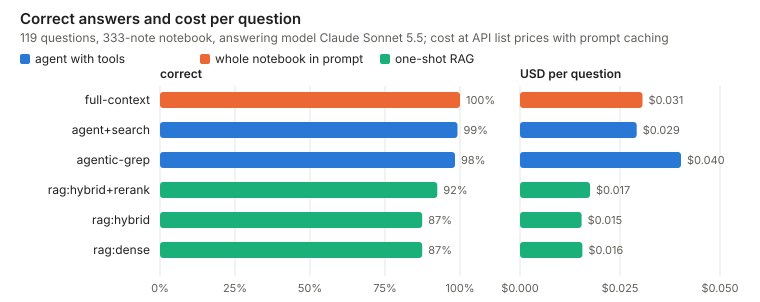
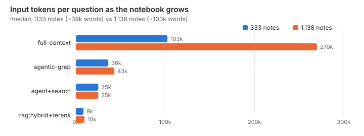

# personal-rag-eval

[English](README.md) · **Русский**

[](https://github.com/dmitrykarpushkin/personal-rag-eval/actions/workflows/ci.yml)
[](LICENSE)

**Как ИИ-ассистенту искать по заметкам одного человека? Классический RAG проигрывает агенту, который ищет сам.**

Воспроизводимый бенчмарк для тех, кто делает ассистента поверх личных заметок: четыре способа отвечать на вопросы
по двуязычной (английский + русский) записной книжке, проверка на 119 вопросах с доверительными интервалами
и ценой одного ответа. Оценка механическая, без LLM-судьи.



## Что выяснилось

- **Одноразовый RAG — самый слабый способ.** Лучший его вариант (гибридный поиск + реранкер) отвечает верно
  в 92% случаев; агент, который сам грепает папку, — в 98%, вся книжка в промпте — в 100%. Если поиск промахнулся,
  у одноразового RAG нет второй попытки.
- **Дайте агенту инструмент поиска: та же точность, на 27% дешевле.** С гибридным инструментом `search_notes`
  агент отвечает верно в 99% случаев, читает на 31% меньше токенов и делает меньше шагов, чем с одним грепом.
- **Разрыв растёт вместе с книжкой.** При 3,4-кратном числе заметок греп тратит на 18% больше токенов,
  инструмент поиска — столько же, а промпт со всей книжкой стоит в 2,8 раза дороже. Примерно на 4000 заметок
  он перестаёт помещаться в контекст на 1 млн токенов.
- **Основную работу делает семантический поиск.** Греп по ключевым словам находит нужную заметку в топ-5 для 61%
  вопросов, гибридный поиск с реранкером — для 89%; на вопросах на другом языке, чем заметка, — 9% против 100%.
- **Обычное слияние RRF сделало гибридный поиск хуже, чем один плотный.** Помогла взвешенная сумма
  нормированных оценок.

## Четыре подхода

Книжка из 333 заметок, отвечает Claude Sonnet 5.5, 95% бутстреп-интервалы по вопросам:

| | Верно | Медиана входных токенов | Средняя цена ответа |
|---|---|---|---|
| Одноразовый RAG (гибрид + реранкер) | 0,92 [0,87–0,97] | 8 606 | $0,017 |
| Агент с грепом | 0,98 [0,96–1,00] | 36 367 | $0,040 |
| **Агент с грепом + инструментом поиска** | **0,99** [0,97–1,00] | 25 152 | $0,029 |
| Вся книжка в промпте | 1,00 [1,00–1,00] | 102 600 | $0,031 |

В парном сравнении с агентом-грепом на тех же вопросах каждый вариант одноразового RAG хуже, и интервал не
включает ноль; агент с инструментом поиска и вся книжка в промпте на 119 вопросах от него неотличимы. Все таблицы,
прогон на 1138 заметках, поиск с учётом дат, сравнение эмбеддеров и multi-query — в
[docs/results.md](docs/results.md) (на английском).



## Быстрый старт

Юнит-тестам не нужны ни база, ни модели:

```bash
git clone https://github.com/dmitrykarpushkin/personal-rag-eval && cd personal-rag-eval
pip install numpy pyyaml pytest && pytest -q
```

Полному прогону нужен Docker (Postgres 16 + pgvector), а оценке ответов ещё и CLI `claude` с выполненным входом:
`pip install -e . && docker compose up -d --wait && make index goldset eval-retrieval`. Все шаги — в
[docs/method.md](docs/method.md).

## Как устроено

- **Поиск в обычном Postgres:** BM25 считается в SQL, pgvector — для плотного поиска, затем взвешенное слияние
  и, по желанию, реранкер-кросс-энкодер. Эмбеддинги и реранкер работают локально на CPU; платных API в поиске нет.
- **Тот же поиск как MCP-инструмент,** поэтому любой агент может пользоваться им наряду с Grep и Read.
- **Выдуманная книжка, сделанная трудной нарочно:** 333 заметки за полгода (и ещё 805 старых для прогона на
  масштабе), сгенерированные по [описанию мира](spec/world.yaml), которое кладёт каждый факт рядом с устаревшими
  значениями и похожими, но неверными.
- **Золотой набор:** 59 вопросов написаны вручную и 60 синтетических, восемь типов (поиск факта, перефразировка,
  время, идентификатор, агрегат, другой язык, несколько шагов, нет ответа). Ответ засчитывается, если совпали его
  регулярные выражения; «не найдено» засчитывается только на вопросах без ответа.

Схема, устройство бенчмарка и все команды для воспроизведения — в [docs/method.md](docs/method.md).

## Ограничения

Корпус синтетический и написан LLM; настоящие заметки грязнее. 119 вопросов дают широкие интервалы (один вопрос —
0,8 пункта), и большинство систем прогнаны по одному разу; повторные прогоны показывают, что у агентов от 2 до 5%
вопросов меняют исход, так что разница в пункт-два между ними — шум, а отставание одноразового RAG — нет. Цены —
по прайс-листу API из отчёта Claude Code, только для сравнения.

---

Лицензия: [MIT](LICENSE) · Автор: [Dmitry Karpushkin](https://github.com/dmitrykarpushkin) ·
Все люди, компании и события в корпусе выдуманы.
