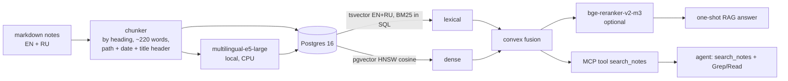

# Method: system, benchmark, limitations, reproduction

Back to the [README](../README.md).

## How it works



- **Storage:** one `chunks` table in Postgres 16 holds a generated `tsvector` (English and Russian stemming side
  by side) and a `vector(1024)` column with an HNSW index ([`src/prag/store.py`](../src/prag/store.py)).
- **BM25 in plain SQL.** Postgres `ts_rank` ignores how rare a word is, and on natural questions it lost to
  naive grep (hit@5 0.51). [`retrieve.py`](../src/prag/retrieve.py) computes BM25 instead (k1 = 1.2, b = 0.75)
  from a `ts_stat` materialised view, which brought it to 0.63 in about 5 ms. With JIT off, because JIT
  compilation alone cost ~400 ms on these small queries.
- **Embeddings and reranker** run locally on the CPU through `sentence-transformers`. There are no paid APIs
  in the retrieval path.
- **Indexing is incremental:** only chunks whose text changed are re-embedded.
- **Agent tool:** [`src/prag/mcp_server.py`](../src/prag/mcp_server.py) is a long-lived streamable-HTTP MCP
  server, so the embedding model loads once. Any MCP client can use it.

## The benchmark

- **Corpus:** a fictional person's notebook covering six months (`corpus/`, 333 notes, ~39k words), plus two
  earlier years for the scaling run (`archive/`, 805 notes). It mixes projects, meetings, email digests,
  journal, inbox voice memos (some in Russian), tasks and money. The notes were generated by LLM agents from
  a world spec ([`spec/world.yaml`](../spec/world.yaml)) that plants each fact in named notes. Each fact has a
  current value and older or near-miss distractors: a dentist appointment moved twice, a rate that changed,
  a flat chosen after leaning the other way, invoice numbers that differ by digit order.
- **Gold set:** 59 questions written by hand from the spec ([`eval/goldset.jsonl`](../eval/goldset.jsonl)) and 60
  synthetic questions written by a separate agent from the notes
  ([`eval/goldset_extra.jsonl`](../eval/goldset_extra.jsonl)). The question types are lookup, paraphrase (the
  question shares no key nouns with the note), temporal (latest value wins), identifier, aggregate (2+ notes),
  cross-lingual, multi-hop and unanswerable.
- **Mechanical checks:** [`eval/build_goldset.py`](../eval/build_goldset.py) verifies that every answer pattern
  occurs in the gold notes, and that temporal distractors do not already contain the current answer.
- **Scoring needs no LLM judge.**
  - An answer is correct when every answer regex matches it.
  - An unanswerable question is correct only on an explicit `NOT_FOUND`.
  - Citations are checked against the gold note paths.

## Limitations

- The corpus is synthetic and written by LLMs. Real notes are messier and more repetitive.
- 119 questions give wide confidence intervals (one question is 0.8 points); the tables show them. Most systems
  were run once; two were run three times to measure run-to-run noise (`run_answers.py --repeat`).
- Latency is wall-clock on a 4-core VM with 4 parallel workers, so it is useful for comparison only. The
  reranker is the slow part on a CPU.
- Costs come from Claude Code's `total_cost_usd` (API list prices, prompt caching on). They are reported for
  relative comparison only; all runs used a subscription.
- The fusion weight was tuned on the hand-written questions. Agent runs are not deterministic.
- One fictional name in the corpus was changed after the runs (the running coach). The index is rebuilt from
  the current files; the published numbers come from the runs before the rename.

## Reproduce

```bash
pip install -e .                      # Python 3.11+
docker compose up -d --wait           # Postgres 16 + pgvector on :5433
make index                            # chunk + embed + index corpus/ (~2 min on 4 CPU cores)
make goldset eval-retrieval           # retrieval metrics, no LLM needed
PRAG_TODAY=2026-09-30 PRAG_SYSTEMS=hybrid,hybrid+dates PRAG_TAG=-dates python eval/run_retrieval.py
PRAG_TAG=-dates python eval/compare_retrieval.py hybrid hybrid+dates   # paired comparison
python -m prag.mcp_server &           # search tool for the agent runs
make eval-answers report              # needs a logged-in `claude` CLI
python eval/charts.py                 # docs/*.svg
```

For the large notebook: `make corpus-xl`, index it into a second database (`PRAG_DSN=...`), and run the evals
with `PRAG_CORPUS=corpus-xl PRAG_TAG=-xl`.

## Layout

```
src/prag/        chunking, Postgres store, retrievers, local models, MCP server, CLI
spec/            world spec the corpus was generated from, generation prompts
corpus/          the notebook (333 notes)            archive/  two earlier years (805 notes)
eval/            gold set, builders, runners, report, charts; results/ holds every raw answer
```

